

# Infiniroll
### 無限スクロールジョグダイヤル

*くるくる回すだけ。誤タップゼロでどこまでも読める、フローティング・スクロールコントローラー*

---

## ✨ Infiniroll ってどんなアプリ？

**Infiniroll（インフィニロール）** は、スマートフォンでWebページやSNS・長文記事を読むときの **「スクロールしようとした指がリンクや広告に当たって誤タップしてしまうストレス」** を解消するために生まれた、クリックホイール型フローティング・スクロールコントローラーです。

どのアプリの上にも半透明でちょこんと重ねて置けて、**ジョグダイヤルを指でくるくると回すだけ**。広告だらけのページでも、誤タップを気にせず安全・滑らかに無限スクロールを楽しめます。

| 🫧 待機時は半透明ですっきり（初期値 25%） | 🎛️ 触れた瞬間に表示＆戻るボタンにも対応 |
| :---: | :---: |
| 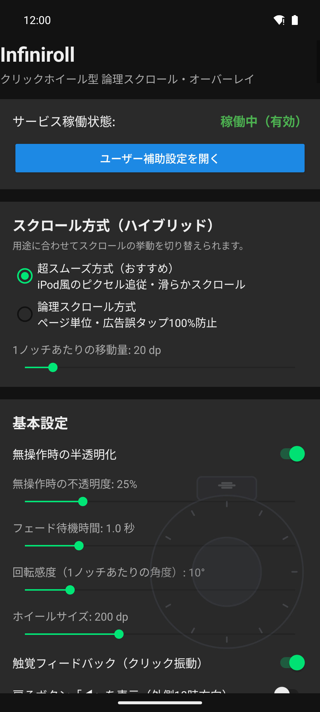 | 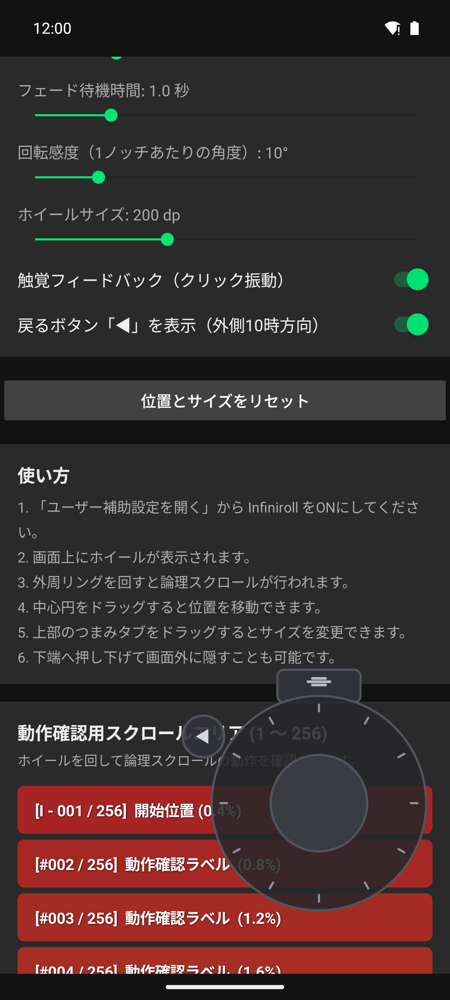 |

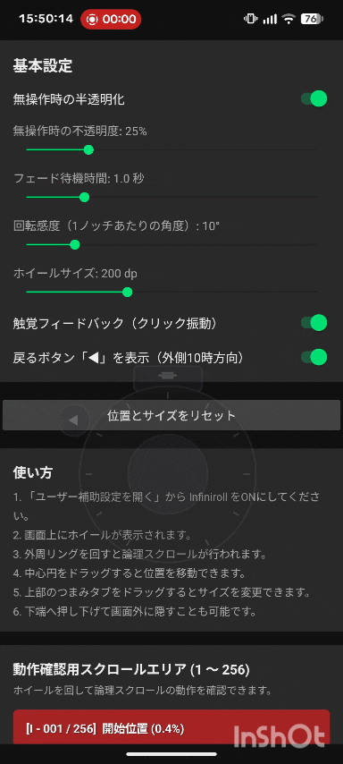

---

## 🎛️ 主な特徴と操作方法

ホイールの各パーツに役割が分かれており、片手の親指だけで直感的に扱えます。下のイラストの**矢印の色**がそれぞれの操作に対応しています。

  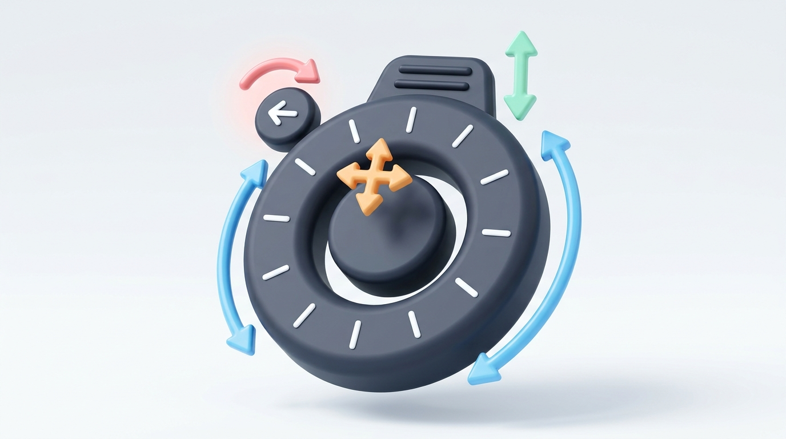

- 🔵 **外周リング（ジョグダイヤル）：スクロール**
  - リングの上を指でなぞって回すとスクロールします（**時計回り ＝ 下へスクロール** ／ **反時計回り ＝ 上へスクロール**）。
  - 勝手な加速や慣性による暴走がなく、**回した分だけ進み、指を止めればピタッと止まります**。
  - ノッチ（目盛り）ごとに「カチッ」と心地よいクリック振動（触覚フィードバック）が返ります。
- 🟠 **中央の円（センターボタン）：位置の移動**
  - ドラッグして画面上の好きな場所へ自由に移動できます。
  - 普段邪魔にならないよう、**画面の端から少し見切れさせて配置**しておくことも可能です（画面回転やサイズ変更で**半分以上**見切れてしまった場合のみ、自動的に画面枠内へスッと引き戻されます）。
- 🟢 **上部のつまみタブ：サイズ変更・画面端への格納**
  - 上下にドラッグすると、ホイールの中心位置を保ったまま全体のサイズ（`120dp`〜`350dp`）を拡大・縮小できます。
  - 画面下端へ押し下げて、つまみタブだけを残して画面外へ格納（ドロワー格納）しておくこともできます。
- 🔴 **外側10時方向の「◀」ボタン（オプション）：戻る操作**
  - 設定画面で ON にすると外周の左上（10時方向）に表示されます（初期設定は OFF）。
  - タップするとブラウザバック（Androidシステムの「戻る」）を送信するため、うっかり誤タップしてしまったときも親指を動かさず即座に前のページへ戻れます。
- 🫧 **自動フェード（半透明化）**
  - 指を離して一定時間が経つと自動的に薄く半透明（初期値 `25%`）になり、背面の記事や画像を邪魔しません。ホイールに触れた瞬間にパッと不透明へ戻ります。

---

## 📱 動作環境

| 項目 | 内容 |
| :--- | :--- |
| **動作確認ベース環境** | **Google Pixel 7 / Android 17** |
| **対応OS要件** | Android 7.0（API 24）以降 |
| **必要な権限** | ユーザー補助サービス（`AccessibilityService`）のみ |

> [!NOTE]
> - 本ページの導入手順およびスクリーンショットは **Google Pixel 7 / Android 17** をベースにしています。お使いの機種やOSバージョンによっては、設定メニューの名称や配置が一部異なる場合があります。
> - 「他のアプリの上に重ねて表示」の個別権限や、外部ツール（Shizuku・PC接続など）は一切不要です。

---

## 🔓 インストールと初期設定手順（サイドロード導入ガイド）

  

本アプリは Google Play ストアではなく、GitHub Releases から APK ファイルを直接ダウンロードしてインストール（サイドロード）します。

Android のセキュリティ仕様（「制限付き設定」）により、**サイドロードしたアプリはそのままではユーザー補助を ON にできません**が、以下の **4ステップ** を順番に進めるだけでかんたんにロックを解除できます。

  <code>📦 Step 1: APKを入れる</code> ➔ <code>⚠️ Step 2: 一度エラーを出す</code> ➔ <code>🔓 Step 3: 制限付き設定を許可</code> ➔ <code>✅ Step 4: ONにして完了！</code>

---

### 📦 Step 1. APKファイルのダウンロードとインストール

1. GitHub リポジトリの **[Releases](../../releases)** ページを開き、最新版の `Infiniroll-vX.Y.apk` をダウンロードして開きます。
2. 初回のみ「この提供元からの不明なアプリをインストールすることはできません」と表示された場合は、**［設定］** をタップし、**［この提供元のアプリを許可］** を ON にして前の画面へ戻ります。
3. 「このアプリをインストールしますか？」と表示されたら **［インストール］** をタップします。
4. Google Play プロテクトの「アプリのスキャンをおすすめします」が表示された場合は、**［アプリをスキャン］**（または **［詳細］→［スキャンせずにインストール］**）をタップしてインストールを完了します。

| ① 不明なアプリの確認 | ② 提供元の許可をON | ③ インストール実行 | ④ Play プロテクト確認 |
| :---: | :---: | :---: | :---: |
| 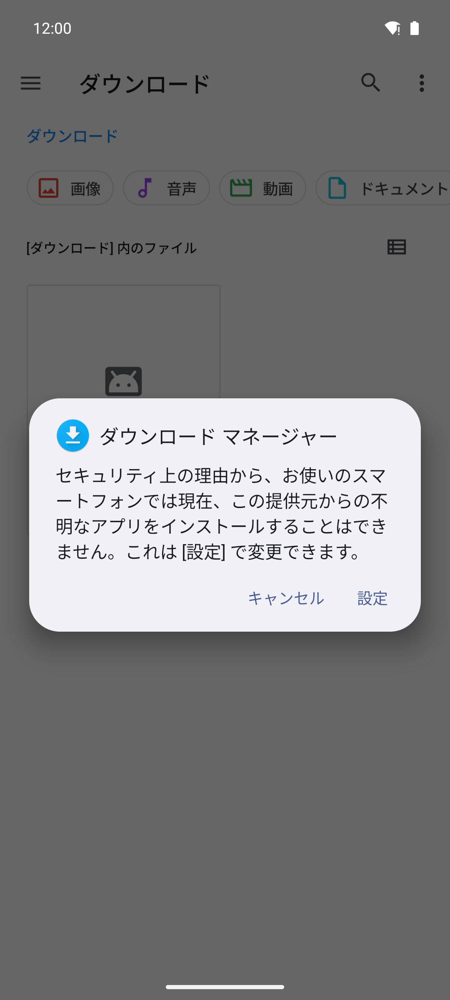 | 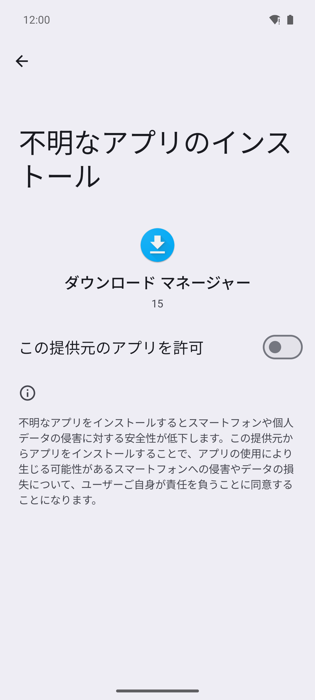 | 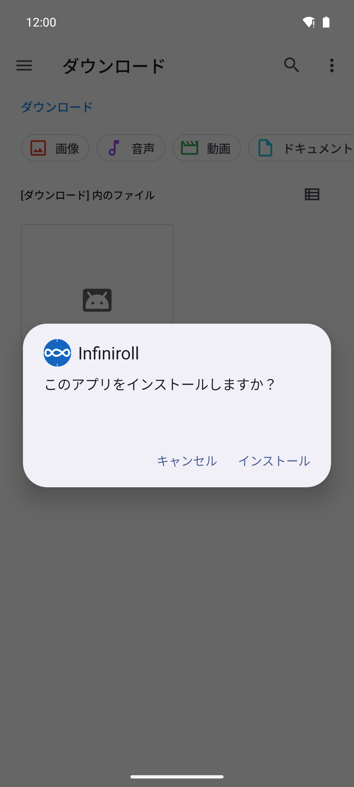 | 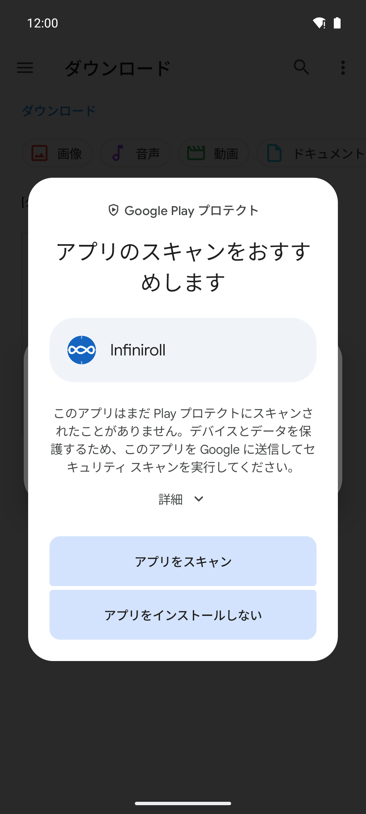 |

---

### ⚠️ Step 2. ユーザー補助で一度「アクセス拒否（エラー）」を表示させる【重要】

> [!IMPORTANT]
> **ここが一番つまずきやすいポイントです！**
> Android の仕様上、**先に一度ユーザー補助の設定画面でエラーダイアログを表示させないと、次の Step 3 で使うロック解除メニュー（「制限付き設定を許可」）自体が出現しません。**

1. インストールした **Infiniroll** を起動し、**［ユーザー補助設定を開く］** をタップします。
2. 「ダウンロードしたアプリ」欄にある **［Infiniroll スクロールオーバーレイ］** は「制限付き設定によって管理されています」と薄くグレーアウトしています。**そのままこの項目をタップしてください。**
3. **「アプリはアクセスを拒否されました」**（OSバージョンによっては「制限付き設定」）というエラーダイアログが表示されます。**［OK］** をタップして閉じます。
   - これで Android 側に「ロック解除メニューを表示するフラグ」が立ちます。

| ① アプリからユーザー補助を開く | ② グレーアウトした項目をタップ | ③ エラーを出して［OK］を押す |
| :---: | :---: | :---: |
| 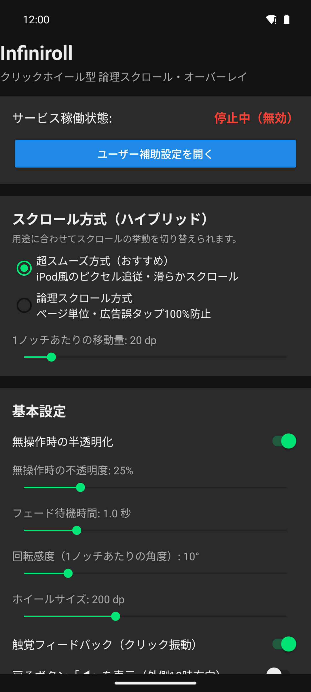 | 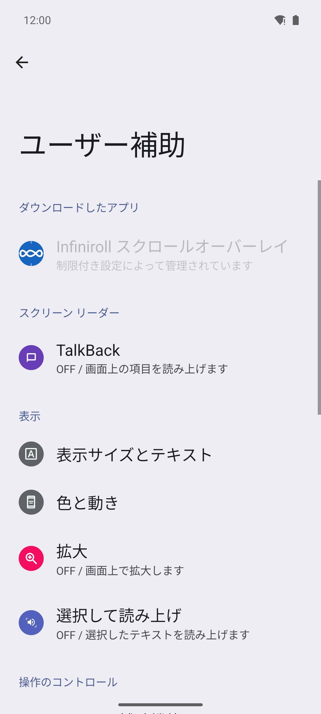 | 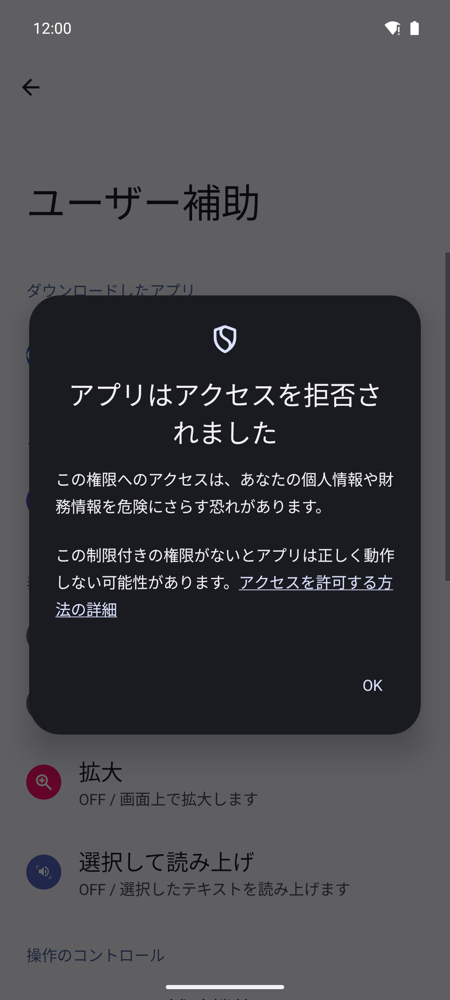 |

---

### 🔓 Step 3. アプリ情報から「制限付き設定を許可」する

1. Android の **［設定］→［アプリ］→［すべてのアプリを表示］→［Infiniroll］** を開きます。
2. 画面右上の **［︙］（3点メニュー）** をタップします。
3. 表示された **［制限付き設定を許可］** をタップし、端末の本人確認（指紋認証・顔認証・PIN入力など）を行います。
   - ※もし右上に［︙］メニューが出ない場合は、Step 2（一度エラーを出す手順）が未実行ですので、Step 2 を先に実行してください。

> [!TIP]
> ホーム画面やアプリ一覧にある **Infiniroll アイコンを長押し →［アプリ情報（ⓘ）］** をタップすると、手順 1 の画面を一発で開けて便利です！

  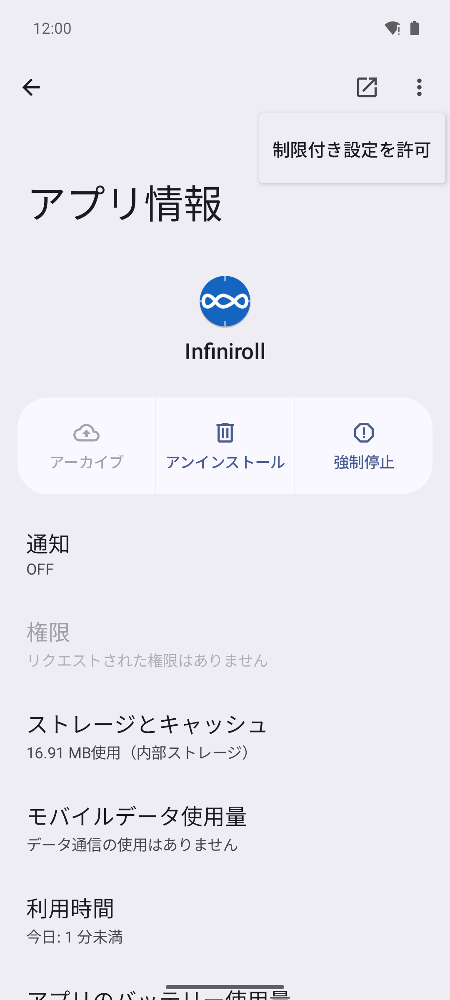

---

### ✅ Step 4. ユーザー補助で Infiniroll を ON にする

1. もう一度 **Infiniroll** アプリに戻って **［ユーザー補助設定を開く］**（または Android の **［設定］→［ユーザー補助］→［Infiniroll スクロールオーバーレイ］**）を開きます。
2. ロックが解除されてスイッチが押せるようになっているので、**［Infiniroll スクロールオーバーレイを使用］** を **ON** にします。
3. 確認ダイアログが表示されたら **［許可］** をタップします。
4. 画面上にジョグダイヤルが出現すれば導入完了です！🎉

| ① フルコントロールの確認で［許可］ | ② スイッチがONになりホイールが出現 |
| :---: | :---: |
| 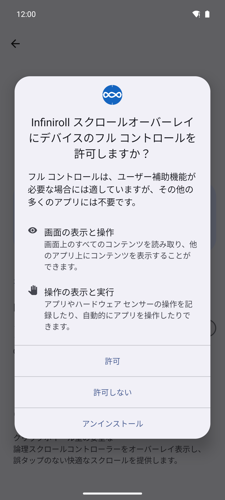 | 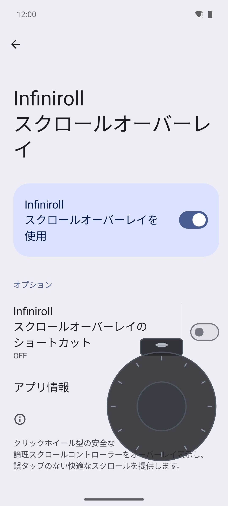 |

> [!TIP]
> **アップデート時の補足**
> 今後のバージョンアップ時は、新しい `Infiniroll-vX.Y.apk` をダウンロードしてそのまま上書きインストールできます。一度許可した「制限付き設定」や各種カスタマイズ設定がリセットされることはありません。

---

## ⚙️ 設定項目のご案内

Infiniroll アプリ内の設定画面から、好みに合わせて細かくカスタマイズできます。画面下部には、別アプリへ切り替えなくてもその場で回転テストができる **`1〜256` の動作確認用スクロールエリア** も備えています。

### スクロール方式（3種類のハイブリッド切替）
- **超スムーズ方式（おすすめ・初期設定）:** 微小な縦ドラッグ信号を連続送信し、指の回転に合わせてピクセル単位で滑らかに追従します。タップ判定を含まないためリンクや広告の誤タップも防ぎます。
- **論理スクロール方式:** Android のスクロール可能領域へ論理スクロール命令を直接送る方式です。移動単位は大きめですが、物理的なタッチ座標を使わないため誤タップを100%防止します。
- **ボタン方式（論理スクロール）:** ホイールの上下に大きな「▲」「▼」ボタンを表示し、タップまたは長押しで論理スクロールを実行します。回転操作が苦手な場合や端末特性で回転が拾われにくい場合でも、親指を置くだけで確実にスクロールできます（約0.3秒の長押しでテンポよく自動連続スクロール）。誤タップを100%防止します。

### カスタマイズ項目一覧

| 設定項目 | 調整範囲 | 初期値 | 説明 |
| :--- | :---: | :---: | :--- |
| **1ノッチあたりの移動量** | `5dp` 〜 `150dp` | `20dp` | 超スムーズ方式での1目盛りあたりのスクロール距離 |
| **回転感度（角度）** | `3°` 〜 `45°` | `10°` | 1ノッチ発火に必要な回転角度（小さいほど細かく反応） |
| **無操作時の半透明化** | `ON` / `OFF` | `ON` | 指を離したあと自動で薄くフェードさせるか |
| **無操作時の不透明度** | `10%` 〜 `80%` | `25%` | 半透明待機時のホイールの濃さ |
| **フェードまでの待機時間** | `0.3秒` 〜 `5.0秒` | `1.0秒` | 指を離してから半透明になるまでの秒数 |
| **ホイールサイズ** | `120dp` 〜 `350dp` | `200dp` | オーバーレイ全体の直径サイズ |
| **触覚フィードバック** | `ON` / `OFF` | `ON` | ノッチ回転時の「カチッ」というクリック振動 |
| **戻るボタン「◀」を表示** | `ON` / `OFF` | `OFF` | 外側10時方向にブラウザバック用ボタンを表示 |
| **アプリ起動ボタン「≡」を表示** | ON / OFF | OFF | 外側2時方向にワンタップで設定画面を前面起動するボタンを表示 |
| **位置とサイズをリセット** | ワンタップ実行 | — | 他の設定は保持したまま、画面端に隠して見失ったホイールを初期位置・標準サイズ（200dp）へ復元 |
| **すべての設定をデフォルトに戻す** | 確認ダイアログ後実行 | — | スクロール方式・各種感度・半透明・振動・戻るボタン・位置サイズを含む全設定を初期値へ一括復元 |

---

## 🛠️ Appendix（開発者・AI向けリポジトリ説明）

### ドキュメント構成
- **[SPEC.md](SPEC.md)**: 本アプリの全体仕様書です。機能、アーキテクチャ、UI/UXデザインの定義を記載しています。
- **[SPEC_HISTORY.md](SPEC_HISTORY.md)**: AIとの仕様変更、拡張、議論の決定履歴を追記・蓄積していくログファイルです。

### 仕様変更・拡張のルール
1. 本リポジトリの設計や機能の変更・追加を行う際は、まずAIとの対話を通じて議論・決定を行います。
2. 決定した内容および仕様の差分は、必ず **`SPEC_HISTORY.md`** に履歴として追記します。
3. 必要に応じて **`SPEC.md`** の該当セクションをアップデートし、最新の仕様状態を常に同期させます。
